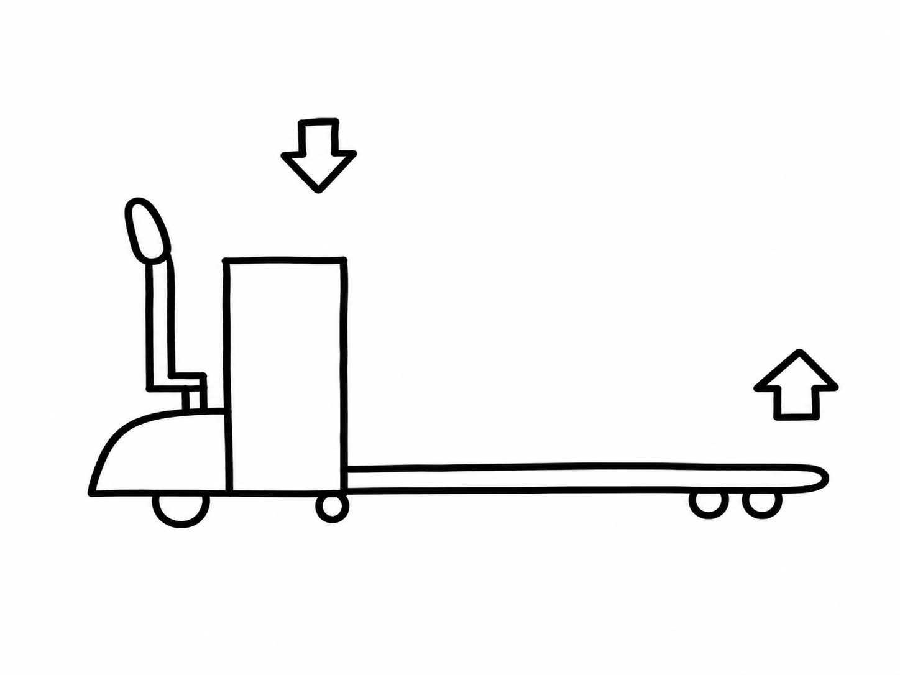

# ABMD15 補助車輪の効果と弊害

Oct 22, 2026 · @bishamon 技術部 佐倉

補助車輪はABMD15の抜き差しを大きく改善しました。10/19には補助車輪を十分に接地させることで、無負荷の自動抜きも引きずりながらですが抜けました。

## 目的と概要

ABMD15で、片面パレット（日本プラパレ製1,100X1,100）にフォークを抜き差しできるようにするのが目的です。その対策として補助車輪を追加し、2026/10/12〜10/19に効果を検証しました。

| 項目 | 内容 |
| --- | --- |
| 対象機種 | ABMD15 |
| 追加部品 | 補助車輪（10/12の前週に取り付け） |
| ねらい | フォーク先端の荷重を抜き、ホイールフォークの引っ掛かりを減らす |
| 比較対象 | 補助車輪なしのABMD15（2台目を復旧して検証） |
| 併用した対策 | イヤーにそりを溶接（10/14）、ホイールフォークの出っ張りを削る（10/19） |

## 抜き差しに有利な理由

補助車輪が床に接地してフォーク先端の荷重を受けるため、ホイールフォークがパレットに引っ掛かりにくくなります。

補助車輪が接地すると本体側に荷重がかかり（下向き矢印）、フォーク先端の荷重が抜けます（上向き矢印）。

1. フォークを下げると、補助車輪が床に接地する
2. フォーク先端にかかっていた荷重が補助車輪側に抜ける
3. ホイールフォークがパレットに強く当たらなくなり、引っ掛かりが減る
4. 差し込みは無負荷でもでき、抜きも荷重がかかっていれば可能になる

引っ掛かりは減りますが、なくなるわけではありません。また、効果を確実に出すには補助車輪が床にしっかり接地している必要があります（「補助車輪の効果を出すための条件」を参照）。

## 検証で確認した効果

補助車輪なしでは全荷重で抜けなかったのに対し、補助車輪ありでは手動の抜きがすべての荷重で可能になりました。

| 荷重 | 手動 差し込み（なし → あり） | 手動 抜き（なし → あり） | 自動 抜き（なし → あり） |
| --- | --- | --- | --- |
| 50kg | 〇 → 〇 | × → 〇 | × → △ |
| 25kg | 〇 → 〇 | × → △ | × → △ |
| 無負荷 | △ → 〇 | × → △ | × → × |

〇＝問題なく可、△＝引っ掛かり・引きずり後に可、×＝不可。「あり」は補助車輪のみ（そりなし）の結果です。

イヤーにそりを加えると、手動の25kg・50kgは引っ掛かりなく抜け、自動でも引っ掛かりがさらに減りました。

10/19には、ホイールフォークの出っ張りを削り、補助車輪を床に十分接地させる対策を行いました。その結果、自動抜きは全荷重で改善し、これまで抜けなかった無負荷も引きずりながら抜けました。

| 荷重 | 手動 差し込み（あり → 接地） | 手動 抜き（あり → 接地） | 自動 抜き（あり → 接地） |
| --- | --- | --- | --- |
| 50kg | 〇 → 〇 | 〇 → 〇 | △ → 〇 |
| 25kg | 〇 → 〇 | △ → 〇 | △ → 〇 |
| 無負荷 | 〇 → 〇 | △ → △ | × → △ |

「あり」は補助車輪のみ（10/13時点）、「接地」は補助車輪を床に十分接地させた状態（10/19の対策後）の結果です。

## 補助車輪の効果を出すための条件：接地タイミングと接地力

補助車輪の効果は、差し込みと抜きのどちらでも、補助車輪が床に十分接地した状態で動作したときに出ます。

10/13の自動抜きの検証では、オートフォークダウンで下限LSに達した時点で、補助車輪が十分に接地しないまま抜き動作に入っていました。そこで、補助車輪が接地するまでもう少し下げるようにプログラムを修正しました。補助車輪を採用する場合は、この下降量と接地状態の確認を制御に組み込む必要があります。

10/19には、接地力の不足も分かりました。自動で引きずりながら抜ける様子を観察すると、床面によって補助車輪がうまく接地しない箇所がありました。引きずる途中て補助車輪が床にしっかり接地すると、パレットから抜けていきました。

そこで、下限ストッパーで下限を決めるのをやめ、補助車輪がしっかり接地するまで下げるようにしました。あわせて、下降しきった後も下降バルブを開けたままにして抜くよう、プログラムを修正しました。この対策で、無負荷の自動抜きが初めて引きずりながら抜けました。

## 弊害・制約

補助車輪に重心がかかるため、機体が補助車輪を中心に動いてしまいます。これが手動・自動の両方で、操作や走行に影響しています。

### 確認できている弊害

| 区分 | 弊害 | 内容 |
| --- | --- | --- |
| 手動 | 操作感の悪化 | 補助車輪に重心がかかり、補助車輪を中心に機体が動いてしまうため、手動での操作感が悪くなる |
| 自動 | 磁気テープへの復帰不良 | オートフォークダウン後、パレットから抜けて磁気テープへ復帰する際も補助車輪を中心に動いてしまい、うまく磁気テープへ復帰できない |
| 共通 | 制御の変更 | 補助車輪を十分に接地させるため、下降量を増やし（10/13）、下限ストッパーをやめて下降バルブを開けたままにする（10/19）プログラム変更が必要 |
| 共通 | 床面による接地不良 | 床面によって補助車輪が十分に接地せず、効果が出ない箇所がある（10/19） |
| 共通 | コスト・保守 | 部品点数が増え、コストと補助車輪のメンテナンスが増える |

## 今後の検討事項

- [ ] 補助車輪を中心に機体が動いてしまう問題（手動の操作感、磁気テープへの復帰）への対策を検討する
- [ ] 補助車輪の接地を安定させる方法（床面の影響、下限の決め方、下降バルブの扱い）を検討する
- [ ] 無負荷の自動抜きで、引きずらずに抜ける状態を目指す
- [ ] 効果と弊害を比べて、補助車輪を採用するか判断する
